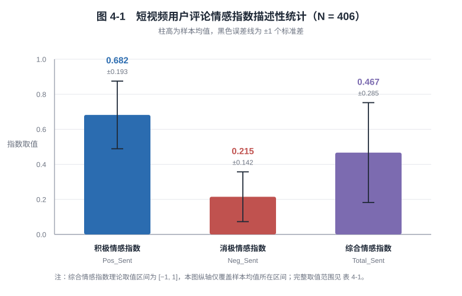
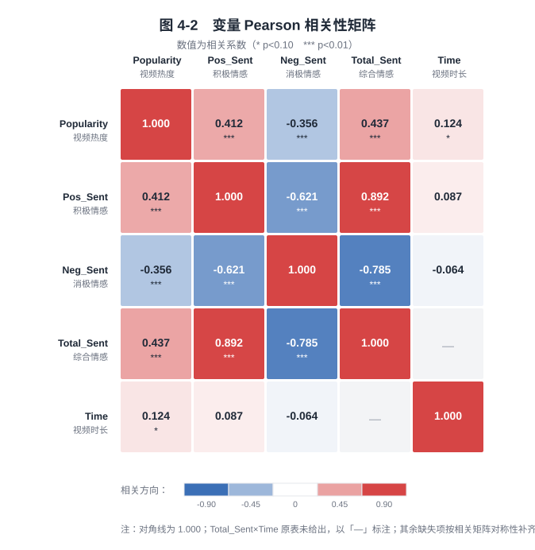
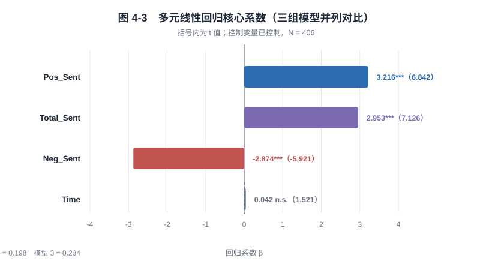
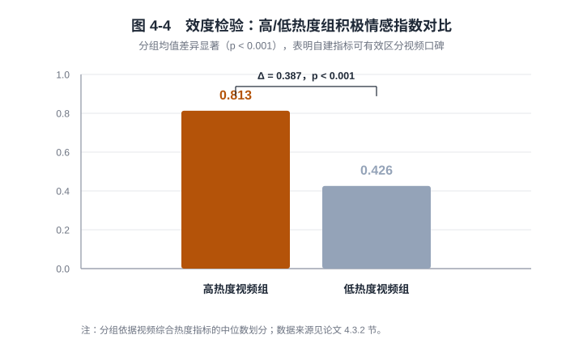

# 图表索引

本目录收录论文全部图形（矢量 SVG，可直接缩放、可无损印刷）。所有数值均取自论文正文与表格，未做任何数据改动。

| 编号 | 文件 | 对应论文位置 | 数据来源 |
| --- | --- | --- | --- |
| 图 3-1 | `fig3-1_NLP五步处理流水线.svg` | 3.3 节 完整 NLP 五步处理流水线 | 论文 3.3 节文字描述 |
| 图 4-1 | `fig4-1_情感指数描述性统计.svg` | 4.2 节 描述性统计 | 表 4-1 |
| 图 4-2 | `fig4-2_变量相关性热力图.svg` | 4.4 节 相关性分析 | 表 4-2 |
| 图 4-3 | `fig4-3_多元回归系数.svg` | 4.5 节 多元回归结果 | 表 4-3 |
| 图 4-4 | `fig4-4_效度检验分组对比.svg` | 4.3.2 节 效度检验 | 论文 4.3.2 节正文 |

---

## 图 3-1　可复现的 NLP 五步测度构建流水线

## 图 4-1　短视频用户评论情感指数描述性统计（N = 406）

## 图 4-2　变量 Pearson 相关性矩阵

> 原表 4-2 仅列出 `Popularity`、`Pos_Sent`、`Neg_Sent` 三个变量作为行；绘图时按其对称性补齐了 `Total_Sent`、`Time` 两行。原表未给出的 `Total_Sent × Time` 单元格以「—」标注，未做任何推测填充。

## 图 4-3　多元线性回归核心系数（三组模型并列对比）

## 图 4-4　效度检验：高/低热度组积极情感指数对比

---

## 说明

- 原稿 `.docx` 中**未嵌入任何位图图表**，正文中的图形信息全部以 3 张数据表格（表 4-1 ~ 表 4-3）承载。本目录中的图 4-1 ~ 图 4-4 为**依据这些表格与正文数值重绘**的图形化呈现，用于提升可读性。
- 三张原始表格本身已完整导出至 [`../tables/`](../tables)，格式为 Markdown 与 CSV 双份。
- SVG 文件使用系统字体族 `Microsoft YaHei / PingFang SC / Segoe UI`，在任何现代浏览器与 GitHub 页面中均可正常渲染。
