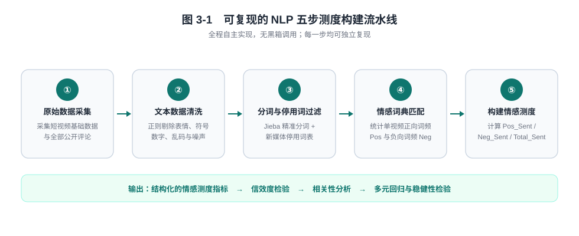

# NLP 五步处理流水线

> 对应论文 3.3 节「完整 NLP 五步处理流水线」与 2.2 节「中文文本预处理技术」。
> 流水线全程自主实现，**无黑箱调用**，每一步均可独立复现。



---

## 步骤一　原始数据采集

批量采集短视频基础数据与评论文本数据，整合为原始数据集，**保留原始数据备份**，保证研究可追溯。

采集字段分两大模块：

- **文本数据**：短视频全部用户公开评论内容；
- **结构化数据**：对应视频的点赞量、评论量、转发量、视频时长、视频分类。

## 步骤二　文本数据清洗

利用 Python **正则表达式**清洗文本，去除表情、符号、数字、空格、乱码，统一文本格式，过滤无效噪声数据。

论文 2.2 节给出的四条预处理规范：

| 序号 | 环节 | 操作要点 |
| --- | --- | --- |
| 1 | 文本清洗 | 正则剔除评论中的表情符号、特殊标点、数字、乱码、重复无效字符，保留纯中文文本 |
| 2 | 中文分词 | 短视频评论多为短句口语化文本，采用 **Jieba 精准分词模式**，适配网络用语分词需求 |
| 3 | 去停用词 | 加载**中文新媒体专属停用词表**，剔除「哦、啊、吧、就是、真的」等无语义虚词、语气词 |
| 4 | 文本筛选 | 剔除字数过少、无实际语义的无效评论，提升样本数据质量 |

## 步骤三　分词与停用词过滤

使用 Jieba 分词工具对清洗后的文本进行精准分词，导入新媒体停用词表，过滤无意义语气词、虚词，保留有效语义词汇。

## 步骤四　情感词典匹配统计

导入优化后的短视频专属情感词典，逐条统计单条视频评论的正向词汇总数（`Pos`）、负向词汇总数（`Neg`）。

词典构建方式为：**通用中文情感词典 + 短视频网络情感词扩充**，分为积极、消极两类。

| 词典 | 论文给出的示例词条 |
| --- | --- |
| 积极情感词典 | 好看、精彩、治愈、喜欢、推荐、太绝了、惊艳、实用 |
| 消极情感词典 | 难看、无聊、敷衍、浪费时间、虚假、差评、失望 |

> 论文 2.3 节同时说明：积极/消极词典均以「通用情感词典 + 网络情感词扩充」的方式优化，示例词条仅为词典片段。

## 步骤五　自主构建 NLP 情感测度指标

代入自建数学公式，计算每条视频的**积极情感指数**、**消极情感指数**、**综合情感指数**，生成最终结构化量化指标，用于后续实证分析。

公式与符号说明见 [`02_核心测度公式.md`](./02_核心测度公式.md)。

---

## 步骤六（下游）　指标检验与实证分析

五步流水线的输出送入实证分析环节，顺序为：

```
结构化情感测度指标
      ↓
信度检验（词典分半信度，Pearson r）
      ↓
效度检验（高/低热度组均值差异）
      ↓
描述性统计 → 相关性分析（Pearson）
      ↓
多元线性回归（三组模型）→ 稳健性检验（Z-score 标准化替换）
```

---

## 预处理效果实测数据

论文 4.1 节报告的预处理结果：

| 指标 | 数值 |
| --- | --- |
| 有效语义词汇保留率 | **82%** |
| 高频正向词汇 | 好看、治愈、喜欢、精彩、实用 |
| 高频负向词汇 | 无聊、敷衍、虚假、一般、失望 |

> 论文原文说明：原始评论数据存在大量网络表情、重复字符、无意义短句，经清洗、分词、去停用词后，有效语义词汇保留率达到 82%，数据噪声大幅降低，完全满足情感量化测算要求。
